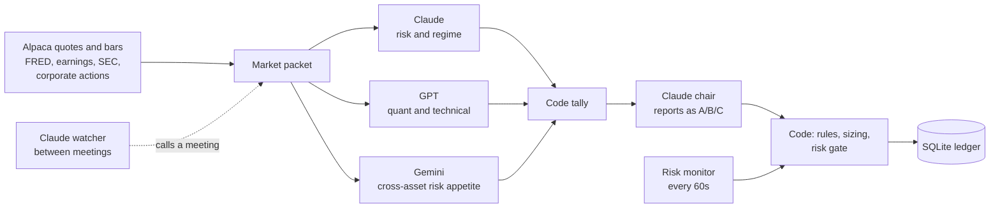

# OTTR

A US-markets paper-trading desk run by three AI models and a rulebook.

Claude, GPT and Gemini each read the same market packet on their own and give a stance on
every asset. A Claude chair reads their anonymized reports and decides what to trade
(GPT stands in if the chair fails).
Between meetings, Claude watches the market and can call a meeting when something changes.
Code does the rest:
- It sizes every order, enforces the risk limits and fills trades at real bid/ask quotes
  with the regulatory fees.
- It keeps exact books with FIFO tax lots, dividends and splits.

The models never choose a dollar amount, never add a symbol and never touch the ledger.

It trades a simulated $10,000 book (no real money):
- **16 core ETFs:** stocks, bonds, cash, commodities and real estate.
- **Up to 6 single stocks:** a code screener picks them every Saturday.
- **Idle cash:** swept into SGOV, the T-bill ETF.

## How a decision gets made



- **The council meets at 10:15 and 15:15 New York time** on trading days.
  - Each analyst returns a stance, conviction, thesis and key risk per asset as validated
    JSON.
  - The chair can propose up to three trades: a BUY with a conviction, or a SELL with a
    fraction of the position.
- **The watcher works between meetings.** After every meeting and every 30 minutes,
  Claude reviews what changed and sets conditions for code to watch, such as "TLT below
  88.50" or "SPY moving 2%". A condition that is met calls a meeting. Code limits this to
  4 calls a day, 45 minutes apart.
- **Code sizes every BUY** from volatility, conviction and the market regime, and only
  tops a position up to its target.
  - It drops a BUY no analyst supported, one in an earnings blackout, one with a corporate
    action pending, and any SELL of an asset the desk doesn't hold.
- **A risk monitor runs every minute in session:**
  - volatility-scaled trailing stops set at entry, which exit at the bid when a holding
    gaps through overnight;
  - concentration and stock-sleeve trims;
  - a drawdown breaker.

  Limits can block new buys, never sells.
- **Every fill is exact and traceable.** It is a marketable limit order at the touch,
  rounded to the tick against the desk. It accrues the 2026 SEC, FINRA and CAT fees and
  commits atomically with its audit record.
- **Everything is recorded:**
  - the packet each model saw, every reply, every verdict and fill;
  - the SPY and 60/40 benchmarks from day one;
  - an after-tax estimate (wash sales, short vs long term).

## Quick start

Requires Python 3.11+, a free Alpaca paper account (market data only), and the `claude`,
Codex and `agy` (Antigravity) CLIs signed in on the same machine. The models run through
those CLIs, so no model API keys live in this repo. For an unattended engine, give Claude
its own sign-in with `claude setup-token` (see [`ottr/README.md`](ottr/README.md#model-sign-in)).

```bash
cd ottr
python -m venv .venv
.venv/Scripts/pip install -e ".[dev]"
cp .env.example .env              # add the Alpaca keys, Alpha Vantage key and SEC user agent
.venv/Scripts/ottr data --check   # every feed answers
.venv/Scripts/ottr init           # opens the $10,000 book, loads the data, runs the first screen
.venv/Scripts/ottr meeting        # one council meeting, propose-only (changes nothing)
.venv/Scripts/ottr run            # start the engine
```

To run it unattended, post to Discord, use the chat bot or read the API, see
[`ottr/README.md`](ottr/README.md).

## Repository

| Path | What's there |
|---|---|
| [`ottr/`](ottr/) | the engine: source, tests, `config.toml` and the operations guide |
| [`docs/DESIGN.md`](docs/DESIGN.md) | how it works and why: the council, the watcher, risk policy, accounting, the screener, tax |
| `.github/workflows/ci.yml` | lint and tests on Linux and Windows |

## Tests

```bash
cd ottr
.venv/Scripts/python -m pytest -q -m "not live"
.venv/Scripts/python -m pyflakes src tests
```
