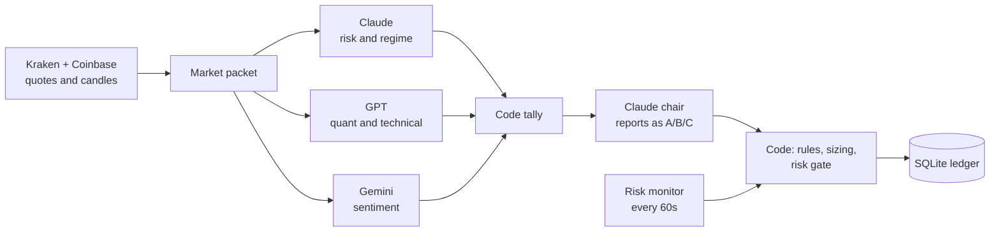

# OTTR

A crypto paper-trading desk run by three AI models and a rulebook.

Claude, GPT and Gemini each analyze the same market snapshot on their own and give a
stance on every coin. A Claude chair reads their anonymized reports and decides what to
trade. Code does the rest: it sizes every order, enforces the risk limits, fills trades
against real bid/ask prices, and keeps exact books. The models never choose a dollar
amount and never touch the ledger.

It trades a simulated book (no real money) in eight coins: BTC, ETH, SOL, XRP, ADA, DOGE,
LINK and AVAX.

## How a decision gets made



- **A council meeting runs every 4 hours.** Each analyst returns a stance, conviction,
  thesis and key risk per coin as validated JSON. The chair can propose up to three
  trades: a BUY with a conviction, or a SELL with a fraction of the position.
- **Code sizes every BUY** from volatility, conviction and market regime, and only tops a
  position up to its target. It drops any BUY no analyst supported and any SELL of a coin
  the desk doesn't hold.
- **A risk monitor runs every minute** with a trailing stop, concentration trims and a
  drawdown breaker. Limits can block new buys, never sells.
- **Every fill is exact and traceable.** It crosses the real spread, pays a realistic fee,
  and commits atomically with its audit record.
- **Everything is recorded.** The packet each model saw, every reply, every verdict and
  every fill, plus BTC and equal-weight buy-and-hold benchmarks to judge results against.

## Quick start

Requires Python 3.11+, and the `claude`, Codex and `agy` (Antigravity) CLIs signed in on
the same machine. The models run through those CLIs, so no API keys live in this repo.

```bash
cd ottr
python -m venv .venv
.venv/Scripts/pip install -e ".[dev]"
.venv/Scripts/ottr init --fresh       # opens a $10,000 paper book
.venv/Scripts/ottr meeting            # one council meeting, propose-only (changes nothing)
.venv/Scripts/ottr run                # start the engine
```

To keep it running unattended, add a Discord webhook for alerts, or call the read-only API,
see [`ottr/README.md`](ottr/README.md).

## Repository

| Path | What's there |
|---|---|
| [`ottr/`](ottr/) | the engine: source, tests, `config.toml` and the operations guide |
| [`docs/DESIGN.md`](docs/DESIGN.md) | how it works and why: council contract, risk policy, accounting, operations |
| `.github/workflows/ci.yml` | lint and tests on Linux and Windows |

## Tests

```bash
cd ottr
.venv/Scripts/python -m pytest -q
.venv/Scripts/python -m pyflakes src tests
```
